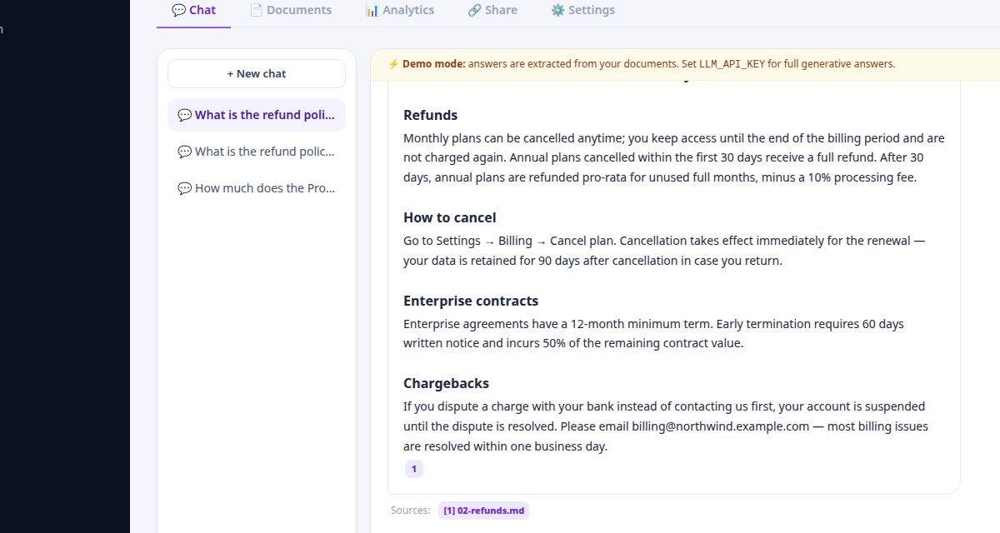

# AskBase — AI answers from your documents

Turn PDFs, Word docs, and help articles into an AI assistant that answers questions **with citations**. Upload documents, chat, embed on any website.



**Demo:** `demo@askbase.com` / `demo1234` (pre-filled on the login page)

## How it works

```
Upload PDF/DOCX/TXT/URL → extract text → smart chunking → local embeddings
    → cosine-similarity retrieval → cited answer (streamed via SSE)
```

- **Local embeddings** (all-MiniLM-L6-v2, 384-dim) — real semantic search, zero API keys
- **Two answer modes:**
  - **LLM mode** — set `LLM_API_KEY` (any OpenAI-compatible endpoint: OpenAI, Groq, Together, Ollama…) for full generative answers with `[n]` citations
  - **Demo mode** (no key) — extractive answers assembled from the top retrieved chunks, always cited
- **Grounded by design** — answers come from retrieved passages or the assistant says it doesn't know; tunable relevance threshold per knowledge base

## Features

- **Knowledge bases** — multiple private collections per org, each with its own chat, docs, and settings
- **Document ingestion** — PDF, DOCX, TXT, MD, CSV uploads (drag & drop) + one-click URL import; background processing with status tracking
- **Streaming chat** — token-by-token SSE responses, conversation history, clickable `[n]` citations opening the source passage
- **Feedback loop** — 👍/👎 per answer, powering the analytics dashboard
- **Analytics** — questions over time, no-answer rate, avg latency, most-cited docs, recent questions
- **Public sharing** — opt-in public chat link per KB (no login required)
- **Embeddable widget** — one `<script>` tag adds a floating chat bubble to any site
- **Developer API** — `POST /api/v1/query` with an API key → `{ answer, citations }` JSON
- **Teams & roles** — multi-tenant orgs (owner/admin/member/viewer); retrieval always scoped to the caller's org
- **Retrieval tuning** — chunk size, overlap, top-K, custom system prompt per KB

## Quick start

```bash
cd server && cp .env.example .env   # set JWT_SECRET; add LLM_API_KEY for generative mode
npm install && node src/index.js    # :4001 — landing at /, app at /app

cd ../client && npm install && npm run build
```

`SEED_DEMO=true` seeds a demo org + knowledge base on first boot.

## Stack

React 18 + Vite + Tailwind · Express + SQLite (`node:sqlite`) + JWT · transformers.js embeddings · SSE streaming

## Project structure

```
server/src/
  index.js  db.js  auth.js  seed.js
  embeddings.js   # local MiniLM / OpenAI embeddings, cosine similarity
  ingest.js       # PDF/DOCX/text/URL extraction + recursive chunking
  rag.js          # retrieval + LLM streaming + extractive demo mode
  routes/         # auth, kb, documents, chat, analytics, apikeys, share
client/src/
  pages/          # AuthPages, Shell, KnowledgeBases, KBDetail (Chat/Docs/Analytics/Share/Settings), WidgetPage
landing/          # marketing site
```
